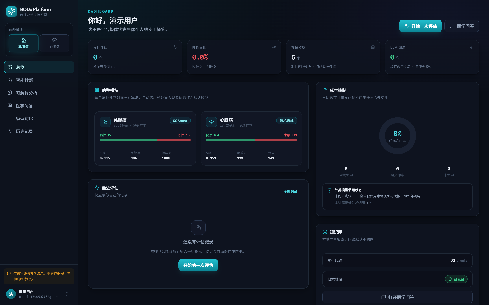
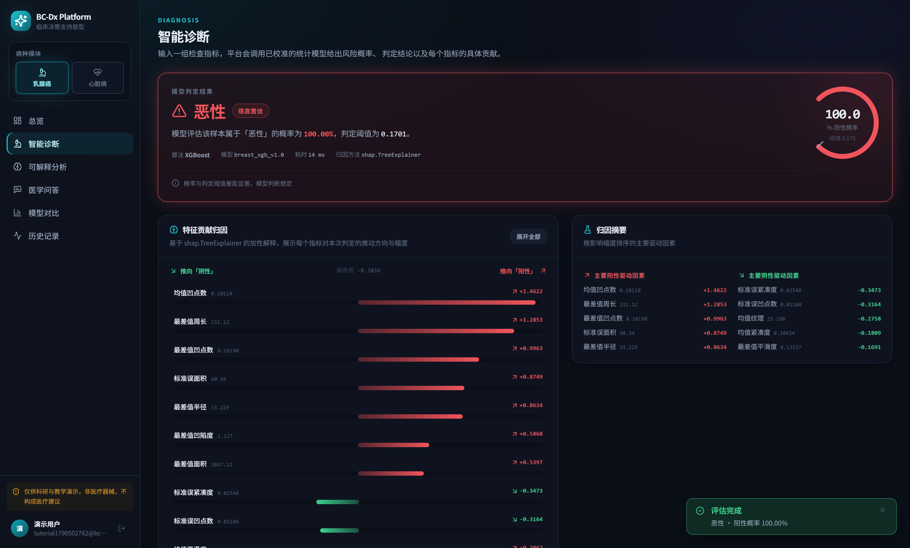
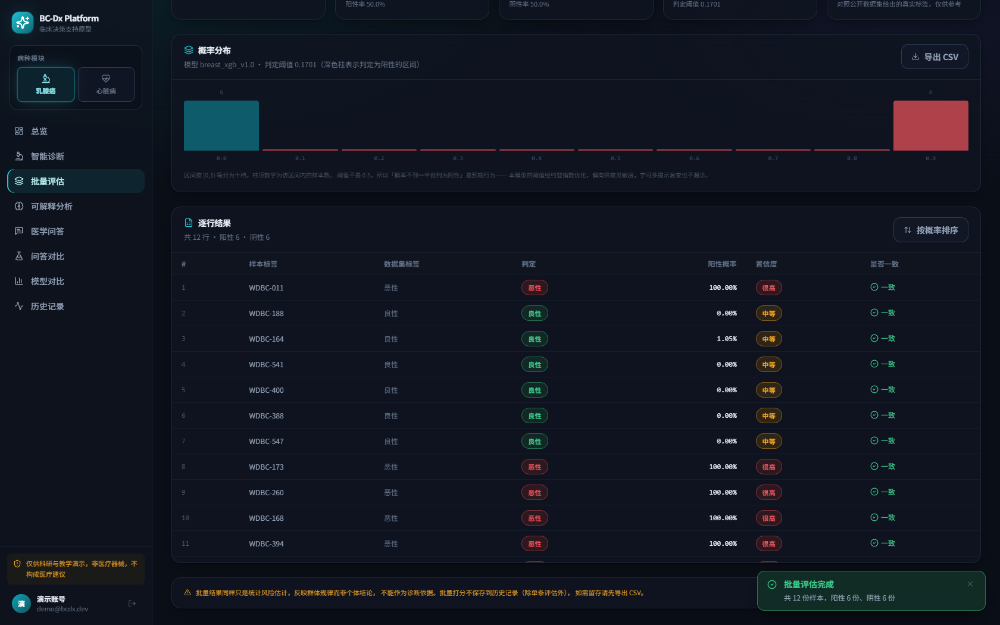
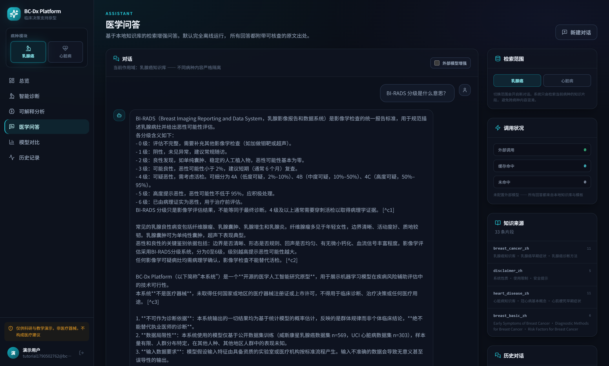
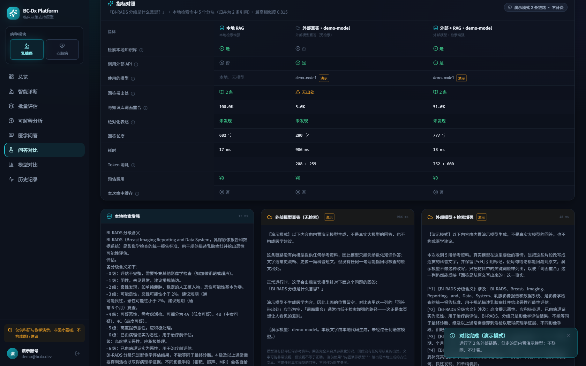
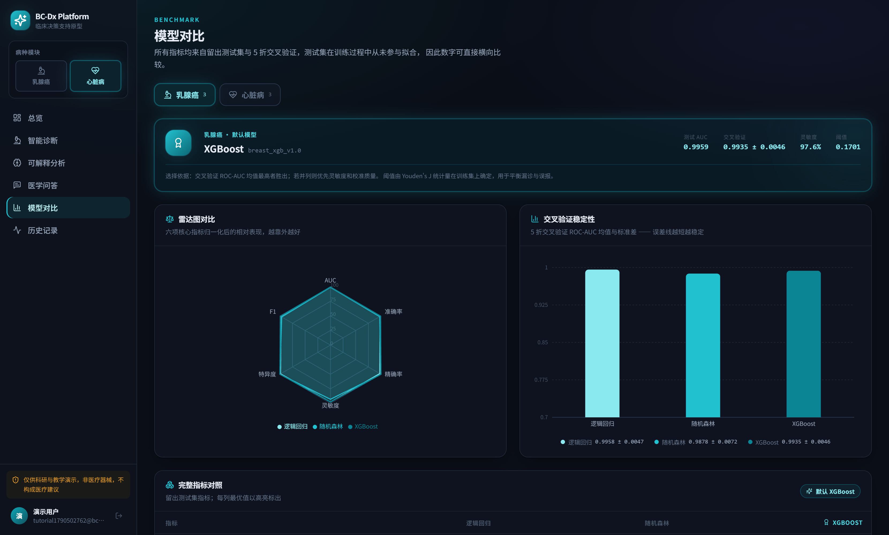
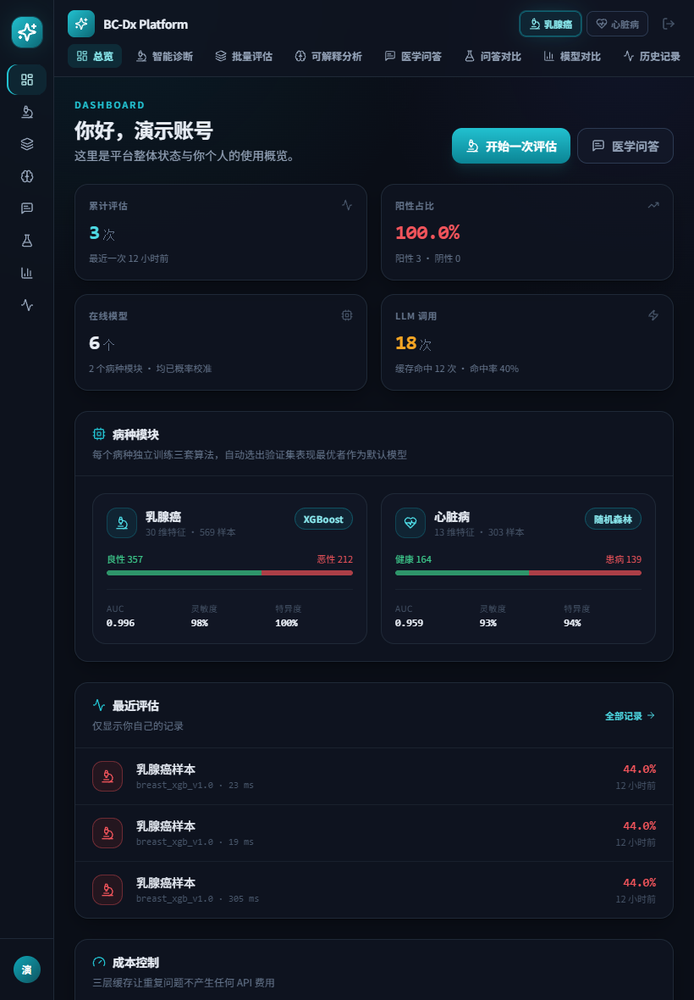
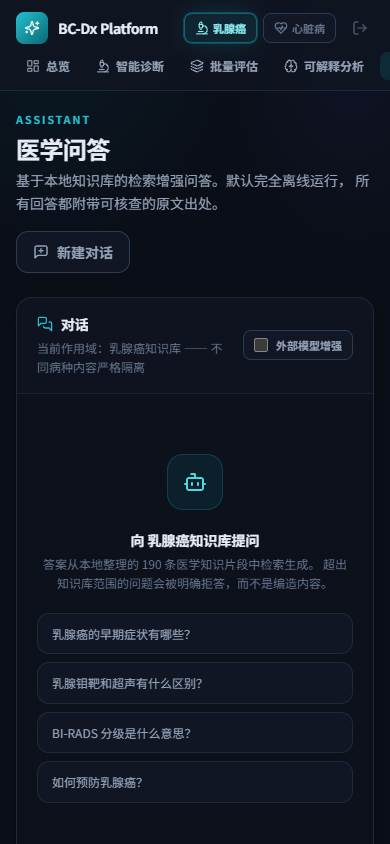

# BC-Dx Platform · 启动与前端检查指南

> 乳腺癌 / 心脏病风险辅助评估平台 —— 全栈开源演示项目。
> **科研与教学演示用途，非医疗器械，不构成医疗建议。**

本文档只做两件事：**怎么启动**、**怎么逐页检查前端效果**。
后端技术原理与架构说明见 [`../ARCHITECTURE.md`](../ARCHITECTURE.md)。



---

## 一、一分钟了解

| 项目 | 说明 |
|---|---|
| 前端地址 | **http://127.0.0.1:5173** ← 你要打开的 |
| 后端地址 | http://127.0.0.1:8000（接口文档 `/docs`） |
| 项目位置 | `C:\Users\ASUS\Desktop\毕设优化\bcdx-platform` |
| 页面数量 | 8 个业务页 + 1 个登录页 |
| 病种模块 | 乳腺癌（30 特征）/ 心脏病（13 特征） |
| 知识库 | 6 个源文件 · 49 KB → **190 个检索片段** |
| 检索方式 | **混合检索**：稠密向量 + BM25 关键词，RRF 融合（默认开）；CrossEncoder 重排已接好、默认关 |
| 外部大模型 | **8 家服务商可选**（DeepSeek / OpenAI / 通义 / Moonshot / 智谱 / Ollama / 演示 / 自定义），默认关闭 |
| 外部 API 费用 | **0**（问答走本地检索；想对比大模型可用**离线演示通道**，仍为 0） |
| 自动化测试 | **427 个用例**，约 60–90 秒 |

---

## 二、怎么启动

### 方式 A：一键启动（推荐）

在资源管理器中打开：

```
C:\Users\ASUS\Desktop\毕设优化\bcdx-platform\scripts
```

**双击 `dev.bat`**。它会：

1. 自动探测一个装了依赖的 Python（优先 Anaconda），找不到会提示怎么装；
2. 检查模型文件（已存在则跳过训练）；
3. 弹出 **两个黑色命令行窗口**：一个是后端，一个是前端。

> 脚本会打印这次实际用的 Python 路径，方便你确认。

### 方式 B：手动开两个终端

```bash
# 终端 1 —— 后端
cd C:\Users\ASUS\Desktop\毕设优化\bcdx-platform\backend
C:\Users\ASUS\anaconda3\python.exe -m uvicorn app.main:app --reload --host 127.0.0.1 --port 8000

# 终端 2 —— 前端
cd C:\Users\ASUS\Desktop\毕设优化\bcdx-platform\frontend
npm run dev
```

> ⚠️ 必须用 **Anaconda 那个 Python**。系统里还有别的 Python 装了但没有 fastapi/sklearn 等依赖，直接用裸 `python` 可能报 `ModuleNotFoundError`。

### 方式 C：只启动前端

后端已经在跑（或你不关心数据）时：

```bash
cd C:\Users\ASUS\Desktop\毕设优化\bcdx-platform\frontend
npm run dev
```

### 怎么判断「已经可以用」

| 服务 | 就绪标志 |
|---|---|
| 前端 | 终端出现 `Local: http://127.0.0.1:5173/` |
| 后端 | 终端出现 `startup complete`；问答功能还需等 `RAG index built: 190 vectors` |

**首次启动后端需要 20–30 秒**（要加载 6 个模型 + 构建本地向量索引）。

- 登录页、总览、诊断、批量评估、对比页：后端一起来就能用；
- **医学问答 / 问答对比页**：要等 `RAG index built` 出现后才正常，否则会一直显示「正在检索知识库…」。

---

## 三、登录账号

打开 http://127.0.0.1:5173 会自动跳到登录页。可用账号：

| 账号 | 密码 | 角色 | 说明 |
|---|---|---|---|
| `demo@bcdx.dev` | `demo12345` | user | **推荐**。登录页有「填入演示账号」按钮可一键填入 |
| `tutorial1790502762@bcdx.dev` | `tutorial12345` | user | 已预置 6 条预测记录、15 个问答会话，**适合检查历史记录页** |
| `arch1790498911@bcdx.dev` | `arch12345` | admin | 管理员账号 |

也可以自己点「注册」新建：

- 密码至少 8 位；
- **第一个注册的账号会自动成为管理员**（想验证这条就删掉 `backend\bcdx.db` 再重启）；
- 每个账号的记录互相隔离，看不到别人的数据。

---

## 四、前端检查清单

按侧栏顺序走一遍。每页给出「看点 / 怎么试 / 预期」。

---

### 4.1 登录页

**路径**：自动跳转 · **截图**：`screenshots/01-login.png`

**看点**
- 左侧品牌区：渐变 Logo、网格纹理、青绿光晕、三条能力说明
- 右侧表单：邮箱 / 密码、密码可显隐（眼睛图标）
- 底部医疗免责声明

**怎么试**
1. 点 **「填入演示账号」** → 邮箱密码自动填好
2. 点「登录」→ 右上角出现成功提示 → 跳转到总览

**预期**：登录成功提示 `登录成功 · 欢迎回到 BC-Dx Platform`，页面进入总览。

> 顺手验证表单校验：直接点登录会提示「请输入邮箱」；注册模式下密码少于 8 位会提示「密码至少 8 位」。

---

### 4.2 总览 Dashboard

**路径**：`/dashboard` · **截图**：`screenshots/02-dashboard.png`

**看点**
| 区域 | 你应该看到 |
|---|---|
| 顶部 4 张卡片 | 评估次数、阳性占比、在线模型数、LLM 调用次数（应为 **0**） |
| 病种模块 | 乳腺癌：570 样本 / 30 特征，冠军 **XGBoost**，AUC **0.9959**<br>心脏病：303 样本 / 13 特征，冠军 **随机森林**，AUC **0.9589** |
| 成本控制 | 环形图显示缓存命中率 + 精确命中 / 语义命中 / 未命中 |
| 知识库 | 已索引 **190** 个知识片段，状态「就绪」 |
| 最近评估 | 你最近 6 条记录（新账号为空） |

**怎么试**：点侧栏「乳腺癌 / 心脏病」切换模块，观察卡片与「最近评估」跟随变化。

**预期**：切换病种时数据同步刷新，无报错、无白屏。

> 📌 这一页是**此前修过 bug 的地方**：健康检查接口原先没走代理，导致整页白屏。现在应正常渲染。

---

### 4.3 智能诊断（核心页面）

**路径**：`/diagnosis` · **截图**：`screenshots/03-diagnosis-verdict.png`、`screenshots/04-diagnosis-shap.png`、`screenshots/05-diagnosis-metrics.png`



**看点**
- 输入区按 **均值 / 标准误 / 最差值** 三组折叠（每组 10 个指标），每个输入框下方标注正常范围
- 顶部可选推理算法（默认冠军模型）

**怎么试（完整动线）**

1. 侧栏选病种（先试 **乳腺癌**）
2. 在输入区点 **「填充均值」** → 30 个字段一次性填好
3. 把这几个推高，制造一个「像恶性」的样本：
   `均值半径` → `25`，`均值周长` → `174`，`均值面积` → `1700`，`均值凹点数` → `0.18`
4. 点 **「运行评估」**
5. **向上滚动到页面顶部**看结论卡
6. 继续向下看 SHAP 归因
7. 再向下看模型指标

**预期结果**

第 5 步顶部出现判定卡：

| 字段 | 预期值 |
|---|---|
| 判定结论 | **恶性**（红色徽章） |
| 阳性概率 | 接近 **100%** |
| 判定阈值 | **0.1701**（Youden's J 求得） |
| 所用模型 | `breast_xgb_v1.0` |
| 归因方法 | `shap.TreeExplainer` |
| 耗时 | 十几毫秒到几十毫秒 |

第 6 步 SHAP 图：

- **红色条** = 把结论推向「恶性」，**绿色条** = 推向「良性」
- 每条显示 中文指标名 + 本次取值 + 贡献值（例：`均值凹点数 0.18116 → +1.4492`）
- 右侧「归因摘要」列出主要阳性 / 阴性驱动因素
- 点 **「展开全部」** 可看全部 30 项，点「只看主要项」收起

第 7 步指标条：ROC-AUC **0.9959** / 准确率 99.1% / 灵敏度 97.6% / 特异度 100.0% / Brier **0.0170**

---

#### ⚠️ 一个容易被误判成 bug 的地方：填均值也会得到「恶性」

点 **「清空」** → 点 **「填充均值」** → 直接「运行评估」（不做任何修改）。

**预期**：结论是 **恶性**，阳性概率约 **44%**。

**这不是 bug**，而是**阈值策略**的结果：

- 本平台用 Youden's J 统计量求出的判定阈值只有 **0.1701**，远低于直觉上的 0.5；
- 因为定位偏**筛查**，设计上「宁可多报也不漏报」—— 代价就是"人群平均值"也会被判为阳性；
- 页面上的「判定阈值 0.1701」，以及指标条里的「灵敏度 97.6% / 特异度 100.0%」，正是这条策略的体现。

> 如果你想看到「良性」的绿色徽章，按下面的配方改 8 个字段即可。

---

#### 验证判定方向确实没反（重要）

想确认模型不是把良/恶**判反了**，用这个配方：

1. 点「填充均值」；
2. 把下面 **8 个字段**改成指定值（其余保持均值不动）：

| 字段 | 改成 |
|---|---|
| 均值半径 | `12.86` |
| 均值周长 | `83.19` |
| 均值面积 | `506.3` |
| 均值凹点数 | `0.0232` |
| 最差值半径 | `14.24` |
| 最差值周长 | `91.88` |
| 最差值面积 | `622.1` |
| 最差值凹点数 | `0.0793` |

3. 点「运行评估」

**预期**：结论变为 **良性**（绿色徽章），阳性概率约 **1%**。

> 💡 **一个真实存在的坑**：常用的 `sklearn.datasets.load_breast_cancer` 里 **0 = 恶性、1 = 良性**，而本平台全局约定 **0 = 良性、1 = 恶性**，两者**正好相反**。如果你拿 sklearn 的样本自己标类别、再和这里的结论比对，很容易误以为"模型判反了"。当年原始毕设项目就是栽在这个反向映射上。

> 界面上出现 `⚠ 超出训练分布` 是**正常的保护提示**：说明你输入的值超出了训练数据的取值范围，结论会附带提醒。

---

### 4.4 批量评估

**路径**：`/batch` · **截图**：`screenshots/09-batch-input.png`、`screenshots/10-batch-results.png`、`screenshots/11-batch-table.png`



**看点**
- 左侧是一次评估多份样本的入口：**载入真实样本** 或 **上传 CSV**
- 右侧是结果：汇总卡 + 概率直方图（**阈值线标出阳性区间**）+ 逐行表格
- 表格里每行带 `数据集标签` 与 `是否一致` 两列 —— 可以**直接看出模型错在哪一行**

**怎么试（最省事的路子）**

1. 点 **「载入 12 份真实样本」**
2. 点 **「运行批量评估」**

**预期**

- 汇总卡：`12` 份样本、阈值 **0.1701**、阳性与阴性都不为 0
- 直方图上有一条竖着的阈值线，**落在阈值右侧的区间是阳性**
- 逐行表格：12 行都有判定、概率、数据集标签、是否一致

> **这一页最关键的一点**：这 12 份样本**不是随便编的**，而是从 WDBC 公开数据集里按标签**各抽 6 份**的真实行。
> 早期版本在 `[min, max]` 上均匀取值生成样本，结果 12 份**全都是"恶性 100%"**——因为最大值本身就是由阳性类的上尾定义的。
> 现在 12 行里有恶性也有良性，配上「是否一致」列，才谈得上是评估。

**怎么试（自己传数据）**

1. 点 **「下载 CSV 模板」** 拿到列名
2. 用 Excel 填几行（也可以直接用中文列名，如 `均值半径`）
3. 点上传区选文件 → 自动解析并预览列映射 → 运行

**预期**：解析后提示识别到的列数；缺列会明确报错并指出是哪一列，而不是静默按错位读。

> ⚠️ 有一个真实存在的坑：**批量汇总的阈值是 0.1701，不是 0.5**。一份概率 0.30 的样本会被判为**恶性**。
> 如果拿 0.5 去心算，会觉得"总数对不上"——所以响应里专门返回了 `threshold` 字段，页面上也标了阈值线。

---

### 4.5 可解释分析

**路径**：`/explain` · **截图**：`screenshots/07-explain-result.png`

**看点**：把**同一份数据**同时送进 3 个算法，对比它们的归因差异。

**怎么试**
1. 在左侧填一份数据（也可以先填几个值）
2. 点 **「运行全部 3 个算法」**

**预期**

- 顶部出现 3 张判定卡并排：**逻辑回归 / 随机森林 / XGBoost**，各带概率、AUC、推理耗时
  （示例实测：LR 100.0% 恶性 / RF 78.5% 恶性 / XGB 61.2% 恶性）
- 向下是**三算法归因对照**：同一指标三个模型各自贡献值
- 若某指标上三个模型**方向相反**，会单独列出「归因分歧」区

**这一页的意义**：普通工具只给一个结论，这页告诉你**结论对模型选择有多敏感**。也是最适合给别人演示的一页。

> 对比结果不入历史记录，属于探索性分析。

---

### 4.6 医学问答

**路径**：`/assistant` · **截图**：`screenshots/08-assistant-answer.png`



**看点**
- 完全离线的本地知识库问答，右侧「检索范围」可切换病种
- 回答带 **行内引用标号** `[c1] [c2]`，下方列出可核查的原文出处
- 右侧「调用状况」显示**外部调用 = 0**

**怎么试（正常问答）**
1. 确认检索范围是「乳腺癌」
2. 输入：`BI-RADS 分级是什么意思？`
3. 按 Enter

**预期**：文字**流式逐段出现**（不是一次性蹦出），内容是 0–6 级分级的完整释义，末尾带引用标号与出处列表。

**怎么试（拒答保护）** —— 这是本平台的一个亮点
1. 保持在「乳腺癌」范围
2. 输入：`冠心病应该如何诊断？`
3. 按 Enter

**预期**：**不回答**，而是明确告知该问题超出当前知识库范围，并建议切换到「心脏病」模块。

> 平台有三道闸门防止编造：病种门（跨病种直接拒答）、语义阈值（**命中里最高的原始余弦** < 0.30 拒答）、词法覆盖（**排第一的片段**覆盖率 < 0.12 拒答）。
> 三道闸门的判定顺序、文案差异，以及为什么后两个取的不是同一个"最佳命中"，见 [`KNOWLEDGE_BASE.md`](KNOWLEDGE_BASE.md) 第四、五节。

**怎么试（混合检索）** —— 这 4 个问题是旧版纯向量检索**答不出来**的，现在能答

在「乳腺癌」范围下依次问：

| 问题 | 期望命中的小节 |
|---|---|
| `Youden 指数是怎么用的？` | 判定阈值的作用 |
| `约登指数是什么意思？` | 判定阈值的作用 |
| `数据泄漏为什么会让评估失真？` | 数据泄漏与评估可信度 |

再切到「心脏病」范围问：`房颤是怎么回事？` → 期望命中 **心律失常基本概念**。

**预期**：四条都给出带出处的答案，**没有一条被拒答**。

> 为什么这四条值得单独演示：它们在纯向量检索下**全部被拒答**——句子向量把「Youden」编码成一个靠近"统计学指标"的模糊位置，于是问题被当成"泛泛地问指标"，排序飘到《概率校准与布里尔分数》去了；而那一节与问题**一个内容词都不重合**，词法闸门于是如实拒绝作答。也就是说：**手里有答案，却告诉用户"知识库中没有相关内容"**。BM25 把真正含该词的小节顶到第一，两道闸门同时满足。原理与实测见 [`KNOWLEDGE_BASE.md`](KNOWLEDGE_BASE.md) §4.3。

**怎么确认混合检索真的在跑**（而不是静默降级成纯向量）

```bash
curl -s --noproxy '*' http://127.0.0.1:8000/health | python -m json.tool
```

看 `rag_retrieval` 一节：`mode` 应为 `hybrid`；问过至少一个问题后，`last_query.dense` 与 `last_query.lexical` **应同时非零**——只看到 `dense` 非零说明融合没起作用。

**平板宽度也能切病种**：把窗口拖到 768–1024 px（`md` 区间），左侧栏会收成 64 px 图标窄栏，**病种切换器此时出现在页头**（见 `screenshots/17-tablet-rail.png`）；拖到 640 px 以下同理（`screenshots/18-phone-header.png`）。以前这个切换器只存在于宽屏侧栏，窄屏下**根本无法切换病种**，而本页和批量评估页都按当前病种工作。

---

### 4.7 问答对比

**路径**：`/qa-compare` · **截图**：`screenshots/12-compare-idle.png`、`screenshots/13-compare-metrics.png`、`screenshots/14-compare-reading.png`



**看点**

同一个问题，**三条路径并排作答**：

| 路径 | 用检索 | 外部调用 |
|---|---|---|
| 本地检索增强 | ✅ | ❌ |
| 外部模型直答（无检索） | ❌ | ✅ |
| 外部模型 + 检索增强 | ✅ | ✅ |

表格是**行 = 指标、列 = 路径**，同一行对所有路径施加同一种度量：答案字数、引用条数、词面重合度、绝对化措辞、外部调用、费用、耗时、缓存命中。

**怎么试**

1. 确认右上角检索范围是「乳腺癌」
2. 输入：`BI-RADS 分级是什么意思？`
3. 点 **「开始对比」**

**预期（默认零成本配置下）**

| 指标 | 本地检索增强 | 外部直答 | 外部 + RAG |
|---|---|---|---|
| 状态 | `ok` | `skipped` | `skipped` |
| 答案字数 | 682 | — | — |
| 引用条数 | 2 | — | — |
| 费用（¥） | 0 | — | — |
| 耗时（ms） | 约 40 | — | — |

**这里最容易被误读的一点：`skipped` 不是失败。** 它只说明本部署没有配置 API Key，所以付费路径**按设计**没有执行。对比功能本身完全正常，**费用为 ¥0**。

**怎么试（看懂度量口径）**

1. 向下滚动到 **「怎么读这张表」** 面板
2. 逐条读每个指标的"能说明什么 / **不能**说明什么"

**预期**：面板明确写出——`词面重合度` 高**不等于**正确、低**不等于**错误（中文医学术语高度集中）；`绝对化措辞` 是**浅层关键词筛选，不是安全保证**。

> 💡 这两条"不能说明什么"才是这一页真正的价值。**把度量的局限写出来，比把数字做大更重要。**
> 完整口径见 [`QA_COMPARISON.md`](QA_COMPARISON.md) 第五节。

**想看三列都有内容怎么办**：在 `.env` 里设 `LLM_ENABLED=true` 并填 `LLM_API_KEY`，重启后端。之后外部两列会返回真实回答并记录 Token 与费用；**同一个问题再问一次会命中缓存**，`外部调用` 变 0、`缓存命中` 变 1。

---

#### 4.7.1 外部模型连接面板（页面顶部）

**截图**：`screenshots/15-llm-panel.png`

在同一个 `/qa-compare` 页面的顶部，有一块 **「外部模型连接」** 面板。它把"当前接的是哪家模型、能不能用"直接摆出来，省得你去猜为什么外部两列是空的。

**看点**

| 区域 | 内容 |
|---|---|
| 状态胶囊 | `已就绪` / `演示模式` / `未配置密钥` / `已关闭` —— 四种状态一眼区分 |
| 字段网格 | 服务商、接口地址、模型、密钥（脱敏成 `sk-1***abcd`） |
| 计数器 | 本进程外部调用次数、失败次数 |
| 服务商表格 | **8 家可选**，各自带默认模型、参考价格、控制台链接（点开就能申请密钥） |
| 自检按钮 | **「测试连接」** —— 发一次 **16 token** 的探活请求，成本约为 ¥0.00003 |

**怎么试**

1. 点开面板下方的「查看支持的服务商」
2. 点 **「测试连接」**

**预期（演示通道下）**：约 1 秒后返回绿色 `✓ 连接正常`，显示往返耗时、消耗 token 数、预估费用 **¥0.0000**，以及一句模型回复。

**如果失败**，面板不会只说"调用失败"，而是给出**具体到能不能自己修**的分类：

| 错误类型 | 含义 | 你要做什么 |
|---|---|---|
| `missing_key` | 没填密钥 | 去 `.env` 填 `LLM_API_KEY` |
| `invalid_key` | 密钥无效（401） | 密钥打错了或已吊销，重新申请 |
| `quota` | 余额不足（402） | 充值 |
| `endpoint_not_found` | 地址不对（404） | 检查 `LLM_BASE_URL`（通义必须带 `/compatible-mode/`） |
| `model_not_found` | 模型名不存在（400） | 对照服务商文档改 `LLM_MODEL` |
| `rate_limited` | 触发限流（429） | 等一会儿，或降低并发 |
| `timeout` / `connection` | 网络不通 | 检查代理、防火墙、`LLM_BASE_URL` 是否可达 |

> 面板上会同时显示**服务端返回的原始错误信息**，上面这张表只是帮你快速定位；细节以原始信息为准。
> 逐字段说明见 [`LLM_INTEGRATION.md`](LLM_INTEGRATION.md)。

---

#### 4.7.2 多模型并排对比

**截图**：`screenshots/16-compare-multi-model.png`

一次对比可以带上**多个模型**，表格会把每个模型拆成独立的一列（`外部直答·模型A`、`外部直答·模型B`…）。

**怎么试**

1. 在「使用的模型」输入框里填多个模型名，用逗号或空格分开，例如：
   `deepseek-chat, gpt-4o-mini`
2. 点「开始对比」

**预期**

- 表格从 3 列变成 **5 列**（1 本地 + 2 直答 + 2 检索增强）
- 每个模型的答案**各不相同**
- 输入框下方提示「**将产生 N 条外部链路**」，让你在花钱前先看到代价

**几个刻意的设计**

- **上限 3 个模型**（`.env` 的 `LLM_MAX_COMPARE_MODELS`）。每个模型要两次付费调用，列表不封顶就是账单不封顶；
- 模型名带空格、重复、非法字符会被**自动清洗**，并且接口会把清洗后的列表**回显**出来——被丢掉的模型你能立刻发现，而不是对着少一列的表发呆；
- **模型是缓存身份的一部分**。换成 `model-c` 再跑一次，`外部调用` 会重新变成 2 —— 说明换模型**真的重新调用了**，而不是拿上一个模型的缓存糊弄你。

> **零成本体验多模型对比**：把 `LLM_PROVIDER` 设成 `mock`（演示通道）即可。此时不会出网、不花钱，
> 但整条链路（序列化 → 请求 → 计费估算 → 缓存 → 落库）**和真调用一样跑**，只是回答来自内置演示模型。
> 拿到密钥后把 `LLM_PROVIDER` 换成 `deepseek` 并把 `LLM_ENABLED` 设为 `true`，**其他代码一行都不用改**。

---

### 4.8 模型对比

**路径**：`/compare` · **截图**：`screenshots/06-compare.png`



**看点**
| 区域 | 内容 |
|---|---|
| 冠军卡 | 病种 + 默认模型 + 测试 AUC + CV AUC + 准确率 + 阈值 |
| 雷达图 | 6 项指标（AUC / 准确率 / 精确率 / 灵敏度 / 特异度 / F1）归一化对比 |
| 交叉验证稳定性 | 5 折 CV 的 AUC 均值 ± 标准差柱状图（误差线越短越稳定） |
| 完整指标对照表 | 三算法横向对比，每列**最优值高亮** |
| 混淆矩阵 | 各算法的 TP/FP/FN/TN 卡片 |

**怎么试**：切换「乳腺癌 / 心脏病」，对比两组结果。

**预期**：乳腺癌各项指标明显更高（AUC 0.996）且 CV 方差更小；心脏病 AUC 0.959，CV 波动较大（0.88 ± 0.035）—— 这正是真实数据集的差异，说明指标不是编的。

---

### 4.9 历史记录

**路径**：`/records` · 用 `tutorial1790502762@bcdx.dev` 登录可看到预置数据

**看点**
- 顶部统计卡（总次数 / 阳性数 / 阳性率 / 平均耗时）
- 筛选：按病种、按判定结果
- 分页表格：时间、病种、判定、概率、模型、耗时

**怎么试**
1. 用筛选器选「病种 = 乳腺癌」→ 列表即时过滤
2. 点任意一行的 **「详情」** → 打开抽屉，回看完整输入 + 判定 + 归因
3. 点 **「导出当前页」** → 下载 CSV

**预期**：抽屉里能看到当时输入的每个指标值与归因；导出的 CSV 用 Excel 打开**中文不乱码**（带 BOM）。

> 在诊断页提交过评估后回到这里，新记录应出现在列表顶部。

---

## 五、推荐 8 分钟演示动线

给同学或评审看时，按这个顺序最顺：

| 顺序 | 页面 | 一句话重点 |
|---|---|---|
| 1 | 登录页 | 多用户体系，一键填演示账号 |
| 2 | 总览 | 平台全貌 + 模型指标 + **LLM 调用 0 次**（成本控制） |
| 3 | 智能诊断 | 填数据 → 出结论 → **SHAP 告诉你为什么** |
| 4 | 批量评估 | 一次 12 份样本，**阈值线 + 逐行一致性**（模型错在哪一行看得见） |
| 5 | 可解释分析 | 同一数据 3 个模型对比，**结论是否稳定** |
| 6 | 医学问答 | 追问一个病种外的问题，看**拒答保护**（最能体现严谨性） |
| 7 | 问答对比 | 三条链路并排，**"更流畅的表述"每次约半分钱，重复问不再收费**；顶部面板可**点「测试连接」当场自检**，还能一次对比多个模型 |
| 8 | 历史记录 | 刚才的评估已留存，可回溯可导出 |

> 如果时间只有 3 分钟：**3 → 4 → 7**。诊断展示可解释性，批量展示工程完成度，对比展示对"成本 vs 质量"的清醒判断。

---

## 六、怎么停止服务

- 直接**关闭那两个黑色命令行窗口**即可；
- 如果在同一个窗口跑的，按 `Ctrl + C`；
- 若窗口关了但端口还被占用（僵尸进程）：

```bash
# 查占用
netstat -ano | findstr :8000
netstat -ano | findstr :5173
# 结束（把 <PID> 换成上面查到的数字）
taskkill /F /PID <PID>
```

---

## 七、排错速查

| 现象 | 原因 | 怎么办 |
|---|---|---|
| 双击 `dev.bat` 后提示找不到 Python | 系统里没有装了依赖的解释器 | 按提示执行 `cd backend && pip install -r requirements.txt`，或用 `set BCDX_PYTHON=路径` 指定 |
| 后端窗口报 `ModuleNotFoundError: No module named 'fastapi'` | 用错了 Python（裸 `python` 可能指向别的安装） | 用 Anaconda 的完整路径：`C:\Users\ASUS\anaconda3\python.exe -m uvicorn ...` |
| 浏览器打不开 5173 | 前端还没起来 / 端口被占 | 看前端窗口是否出现 `Local: http://127.0.0.1:5173/`；查端口占用 |
| 后端接口全部失败 | 后端还在启动（要 20–30 秒） | 等日志出现 `startup complete` |
| 问答页一直显示「正在检索知识库…」 | RAG 索引还没建好 | 等后端日志出现 `RAG index built: 190 vectors` |
| 登录成功后被立刻踢回登录页 | 浏览器禁用了 `localStorage` | 用普通窗口访问，别用无痕模式 |
| 诊断页提交后看不到结论 | 结论渲染在**页面顶部** | 往上滚；或提交时会自动平滑滚动到顶部 |
| 输入框大量显示「超出训练分布」 | 填的值超出数据集范围（保护提示，不是错误） | 点「填充均值」用真实分布的值 |
| 问答对比页外部两列是空的 | 本部署未配置 API Key，付费路径**按设计**跳过 | 这不是错误。先看页面顶部「外部模型连接」面板；想填上就在 `.env` 里开启 `LLM_ENABLED` 并填密钥，或把 `LLM_PROVIDER` 设成 `mock` 用演示通道 |
| 「外部模型连接」面板显示**未配置密钥** | 没填 `LLM_API_KEY` | 点面板里的控制台链接申请，或先用 `LLM_PROVIDER=mock` 体验 |
| 点「测试连接」报 `invalid_key` | 密钥错误或已吊销 | 重新复制密钥，注意别带首尾空格 |
| 点「测试连接」报 `endpoint_not_found` | 接口地址不对 | 别残留旧的 `LLM_BASE_URL`——**它只在 `LLM_PROVIDER=custom` 时生效**，命名服务商保有自己的地址；通义必须走 `/compatible-mode/v1` |
| 点「测试连接」报 `model_not_found` | `LLM_MODEL` 写了服务商不认的名字 | 对照面板里的默认模型名修改 |
| 切换服务商后仍报旧地址的错误 | 残留的 `LLM_BASE_URL` 把命名服务商**重定向**了 | 命名服务商**忽略** `LLM_BASE_URL`（这正是不让它生效的原因）；如确实要自定义地址，请显式设 `LLM_PROVIDER=custom` |
| 填了多个模型但表格列数少于预期 | 模型名非法 / 重复，或超过 `LLM_MAX_COMPARE_MODELS` | 接口会把**清洗后的列表**回显出来，对着它看是哪一个被丢了 |
| 每次调用都失败，但配置看起来没问题 | 可能开过演示通道的故障注入 | 看「外部模型连接」面板顶部是否有**故障注入**提示；清空 `.env` 的 `LLM_MOCK_FAULT` 后重启 |
| 批量评估的「阳性数」和按 0.5 心算的不一样 | 阈值是冠军模型的 **0.1701**，不是 0.5 | 以页面上标出的阈值线为准；响应里也返回了 `threshold` |
| 想重置所有数据 | — | 删掉 `backend\bcdx.db` 后重启后端，表会自动重建，**下个注册账号将重新成为管理员** |

---

## 八、截图对照

完整截图在 `docs/screenshots/` 目录，共 **18 张**，可用来对照你本机看到的效果：

| 文件 | 内容 |
|---|---|
| `01-login.png` | 登录页（品牌区 + 表单） |
| `02-dashboard.png` | 总览（统计卡 / 病种模块 / 成本控制 / 知识库） |
| `03-diagnosis-verdict.png` | 诊断结论（恶性 + 阳性概率 100% + 阈值 + 归因方法） |
| `04-diagnosis-shap.png` | SHAP 归因发散条形图 + 模型指标条 |
| `05-diagnosis-metrics.png` | 输入区（按均值/标准误/最差值分组） |
| `06-compare.png` | 模型对比（雷达图 / CV 稳定性 / 指标表） |
| `07-explain-result.png` | 三算法同数据对比（含归因分歧） |
| `08-assistant-answer.png` | 医学问答流式回答 + 引用出处 |
| `09-batch-input.png` | 批量评估输入区（真实样本载入 / CSV 上传） |
| `10-batch-results.png` | 批量评估结果（汇总卡 + 阈值标注直方图） |
| `11-batch-table.png` | 批量评估逐行表格（含数据集标签与是否一致） |
| `12-compare-idle.png` | 问答对比初始态（三条路径说明 + 成本开关） |
| `13-compare-metrics.png` | 问答对比结果主表（三列并排，演示通道下三列都有内容） |
| `14-compare-reading.png` | 问答对比的度量口径说明面板 |
| `15-llm-panel.png` | 外部模型连接面板（状态 + 8 家服务商目录 + 探活成功） |
| `16-compare-multi-model.png` | 多模型并排对比（两个模型 → 5 列） |
| `17-tablet-rail.png` | **平板（820 px）**：侧栏收成 64 px 图标窄栏，**页头带病种切换器** |
| `18-phone-header.png` | **手机（390 px）**：侧栏隐藏，页头保留病种切换器与导航 |





前 16 张是 **1680×1050** 的桌面视口——在那个宽度下侧栏是全宽版、紧凑页头是 `lg:hidden`，
所以既看不到图标窄栏、也看不到页头里的病种切换器。`17`/`18` 专门补上这两档：
**图里页头那对「乳腺癌 / 心脏病」按钮就是修复的证据**——在这个宽度以前根本无法切换病种。

> 截图由 `_tools/` 下的脚本驱动真实浏览器生成（登录 → 种 token → 逐页截图）。
> `09`–`16`：`node _tools/shoot-new-pages.cjs docs/screenshots`；
> `17`–`18`：`node _tools/shoot-responsive.cjs docs/screenshots`（需要 `NODE_PATH` 指向装有 `puppeteer-core` 的目录）。
> `01`–`08` 是更早一轮的截图。
>
> 重新生成前先让后端跑在**演示通道**（`LLM_PROVIDER=mock`、`LLM_ENABLED=true`），
> 否则 `13`/`16` 的外部列会是空的 —— 因为默认配置下它们是按设计跳过的。
>
> `shoot-responsive.cjs` 会**断言**页头确实存在 `[aria-pressed]` 切换器，缺了就报错退出——
> 否则一个坏掉的响应式布局只会产出一张"看起来很正常"的截图。

---

**许可**：MIT（附医疗用途声明 —— 本项目非医疗器械）
