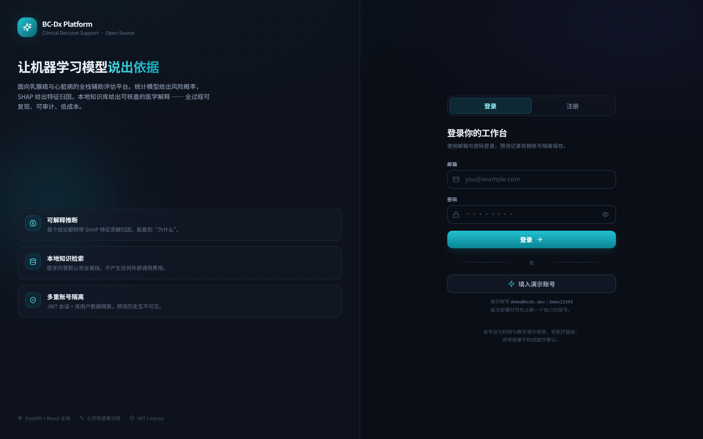
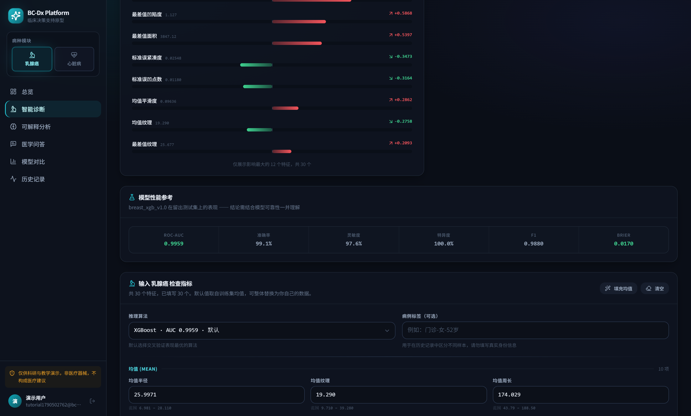
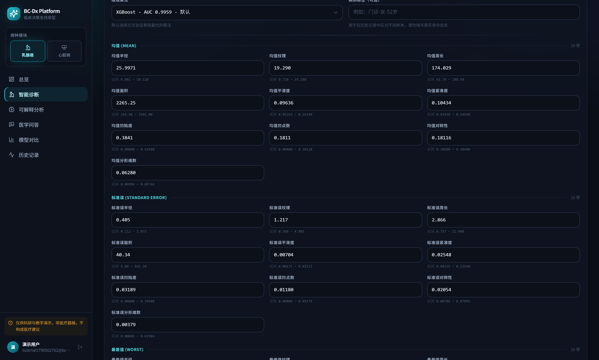
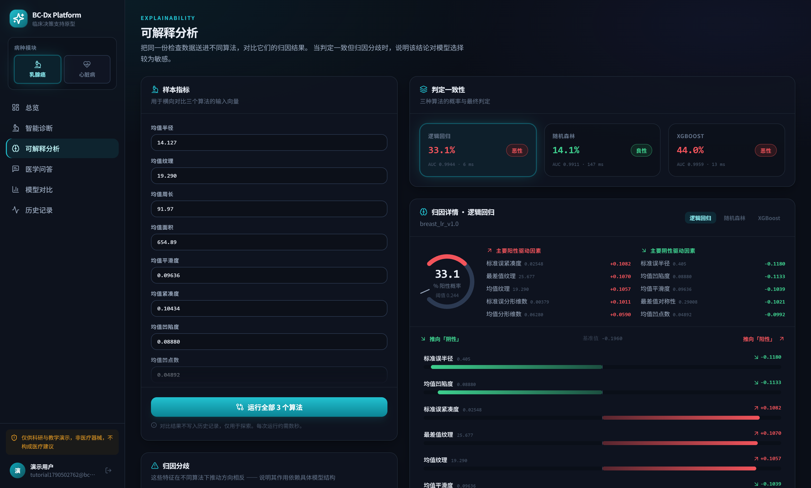

# BC-Dx Platform · 使用教程（v1.0）

> 面向乳腺癌与心脏病风险辅助评估的全栈开源演示平台。
> **仅供科研与教学演示，非医疗器械，不构成任何医疗建议。**

---

## 一、30 秒速览

| | 内容 |
|---|---|
| **前端** | React 18 + TypeScript + Vite 6 + TailwindCSS 3.4（深色临床主题） |
| **后端** | FastAPI + Pydantic v2 + SQLAlchemy 2.0 + SQLite + JWT |
| **机器学习** | scikit-learn Pipeline + CalibratedClassifierCV（LR / RF / XGBoost） |
| **可解释性** | SHAP 结构化归因（TreeExplainer / LinearExplainer）→ JSON 数值 |
| **知识问答** | 全本地 RAG（sentence-transformers + FAISS），**0 次外部 API 调用** |
| **启动方式** | 双击 `scripts/dev.bat`（Windows） |

访问地址：**http://127.0.0.1:5173**

---

## 二、怎么打开（Windows，3 步）

### 第 1 步：确认环境

需要 **Python 3.11+** 与 **Node.js 18+**。首次运行需安装依赖：

```bash
# 后端依赖
cd C:\Users\ASUS\Desktop\毕设优化\bcdx-platform\backend
pip install -r requirements.txt

# 前端依赖
cd C:\Users\ASUS\Desktop\毕设优化\bcdx-platform\frontend
npm install
```

### 第 2 步：一键启动

在文件资源管理器中进入：

```
C:\Users\ASUS\Desktop\毕设优化\bcdx-platform\scripts
```

**双击 `dev.bat`**。脚本会自动：
1. 先启动后端 `uvicorn`（端口 8000）
2. 轮询 `/health` 直到就绪
3. 再启动前端 `vite`（端口 5173）

### 第 3 步：浏览器打开

打开 **http://127.0.0.1:5173** → 自动跳转登录页。

> **手动启动**（若脚本不可用）：
> ```bash
> # 终端 1 —— 后端
> cd C:\Users\ASUS\Desktop\毕设优化\bcdx-platform\backend
> uvicorn app.main:app --host 127.0.0.1 --port 8000
>
> # 终端 2 —— 前端
> cd C:\Users\ASUS\Desktop\毕设优化\bcdx-platform\frontend
> npm run dev
> ```

---

## 三、怎么使用（按页面走一遍）

### 3.1 注册 / 登录



- **注册**：切到「注册」标签，填邮箱 + 展示名称 + 密码（至少 8 位）。
- **首个注册账号自动获得管理员权限**（`role=admin`）。
- 或点「填入演示账号」使用预置账号快速体验。
- 登录后 JWT 存入 `localStorage`（键名 `bcdx.token`），后续请求自动带 `Authorization: Bearer <token>`。

> **多用户隔离**：每个账号的预测记录完全独立，互相不可见。

---

### 3.2 总览 Dashboard


一眼看清平台状态：

| 区域 | 内容 |
|---|---|
| **顶部 4 张卡片** | 累计评估次数 / 阳性占比 / 在线模型数 / LLM 调用次数 |
| **病种模块** | 乳腺癌（570 样本 / 30 特征，冠军 XGBoost，AUC 0.996）<br>心脏病（303 样本 / 13 特征，冠军 随机森林，AUC 0.959） |
| **成本控制** | 环形图显示缓存命中率；精确命中 / 语义命中 / 未命中计数 |
| **知识库** | 已索引 33 个知识片段，检索就绪状态 |
| **最近评估** | 你最近 6 条记录的快捷入口 |

---

### 3.3 智能诊断（核心功能）

#### 输入检查指标

进入「智能诊断」→ 选择病种（侧栏切换乳腺癌 / 心脏病）→ 选择推理算法。

- 每个输入框下方显示 **正常参考范围**，超范围会高亮并给出「⚠ 超出训练分布」提示。
- 点「填充均值」可一键填入数据集均值作为起点。
- ⚠️ 需要注意：由于判定阈值被 Youden's J 压到 **0.1701**（筛查导向、重灵敏度），**填入均值后直接提交会得到「恶性」**，阳性概率约 44%。这是阈值策略的正常结果，不是模型判反了。想验证判定方向，见 `QUICKSTART.md` 里的「验证判定方向」配方。

#### 查看判定结果


提交后顶部出现**模型判定结果**面板：

| 要素 | 说明 |
|---|---|
| **判定结论** | 恶性 / 良性（按全局固定的 `0=良性`、`1=恶性` 语义） |
| **阳性概率** | 校准后的概率（100.0%） |
| **判定阈值** | 由 Youden's J 统计量在验证集上求得（0.1701） |
| **所用模型** | `breast_xgb_v1.0`，耗时 14 ms |
| **归因方法** | `shap.TreeExplainer` |

#### 查看特征归因（SHAP）



- **红色条** = 推向「恶性」，**绿色条** = 推向「良性」。
- 每条显示中文特征名 + 实际取值 + 贡献值（如 `均值凹点数 0.18116 → +1.4492`）。
- 右侧「归因摘要」按影响幅度排序给出 **主要阳性驱动因素 / 主要阴性驱动因素**。
- 默认展示影响最大的 12 个特征，可点「展开全部」查看全部 30 个。

#### 参考模型指标



同一页面下方给出该模型的测试集表现，避免脱离模型可信度理解单次结论：ROC-AUC **0.9959** / 准确率 99.1% / 灵敏度 97.6% / 特异度 100.0% / Brier **0.0170**。

---

### 3.4 可解释分析（三算法对比）



把**同一份检查数据**同时送进 3 个算法，对比它们的归因差异：

- 顶部「判定一致性」卡片：LR 100.0%（恶性）/ RF 78.5%（恶性）/ XGBoost 61.2%（恶性），各附 AUC 与推理耗时。
- 若三者在某些特征上**方向相反**，页面会单独列出「归因分歧」区，提示该结论对模型选择较为敏感。
- 这是本平台区别于普通预测工具的关键设计：**不只给结论，还给结论的稳定性判断**。

> 对比结果不入历史记录，属于探索性分析。

---

### 3.5 医学问答（全本地 RAG）


- **默认完全离线**：基于本地知识库检索 + 拼装，**不产生任何外部 API 费用**。
- 回答带**可核查的原文出处**（行内 `[c1]` `[c2]` 标注 + 右侧「知识来源」列出来源文件与片段数）。
- 「检索范围」可切换乳腺癌 / 心脏病知识库，**不同病种内容严格隔离**。

#### 三重拒答保护

平台有三道闸门，避免编造内容：

1. **Gate 0 · 病种门**：在乳腺癌模块问冠心病，直接拒答并提示切换模块。
2. **语义阈值**：向量相似度低于 `0.30` → 拒答。
3. **词法覆盖**：问题关键词与召回片段的词法重合度低于 `0.12` → 拒答。

拒答不是报错，而是明确告知「本问题超出当前知识库范围」，并建议切换模块或换个问法。

---

### 3.6 模型对比


- **雷达图**：6 项核心指标（AUC / 准确率 / 精确率 / 灵敏度 / 特异度 / F1）归一化后的相对表现。
- **交叉验证稳定性**：5 折 CV 的 AUC 均值 ± 标准差柱状图 —— 误差线越短越稳定。
- **完整指标对照表**：三个算法横向对比，每列最优值高亮。
- 可切换乳腺癌 / 心脏病模块查看各自的冠军模型。

---

### 3.7 历史记录

- 按**病种**（乳腺癌 / 心脏病）与**判定**（阳性 / 阴性）筛选。
- 分页浏览，点击任意记录打开详情抽屉，回看完整输入 + 判定 + 归因。
- 「导出当前页」生成带 BOM 的 CSV（Excel 打开中文不乱码）。

---

## 四、后端技术说明

### 4.1 技术栈

| 层 | 选型 | 作用 |
|---|---|---|
| Web 框架 | **FastAPI** | 异步 HTTP、自动 OpenAPI 文档 |
| 数据校验 | **Pydantic v2** | 请求/响应契约、类型安全 |
| ORM | **SQLAlchemy 2.0** | 声明式模型、会话管理 |
| 数据库 | **SQLite**（`backend/bcdx.db`） | 零配置持久化 |
| 认证 | **PyJWT**（HS256） | 无状态 JWT 会话 |
| 口令 | **passlib + bcrypt** | 密码哈希 |
| 机器学习 | **scikit-learn / XGBoost** | 训练与推理 |
| 可解释性 | **SHAP** | 特征归因 |
| 检索 | **sentence-transformers + FAISS** | 本地向量检索 |

### 4.2 分层架构

```
api/        ← HTTP 路由层（只做校验 + 编排）
  ↓
services/   ← 业务逻辑层（推理、归因、RAG、LLM 网关）
  ↓
ml/ + db/   ← 模型注册表 / 数据访问
  ↑
core/ · schemas/  ← 横切关注点（配置、安全、日志、契约）
```

### 4.3 统一响应信封

除 `/health` 外，所有接口统一返回：

```json
{
  "code": 0,
  "message": "ok",
  "data": { },
  "request_id": "6f13364b98cb"
}
```

`code=0` 表示成功；非 0 为业务错误码。`request_id` 用于串联日志排查。

### 4.4 关键接口

| 方法 | 路径 | 说明 |
|---|---|---|
| `POST` | `/api/v1/auth/register` | 注册（首个账号 = 管理员） |
| `POST` | `/api/v1/auth/login` | 登录，返回 JWT |
| `GET` | `/api/v1/auth/me` | 当前用户 |
| `GET` | `/api/v1/models` | 病种 + 特征 schema + 全模型指标 |
| `POST` | `/api/v1/predict` | 单次预测（可带 SHAP 归因） |
| `POST` | `/api/v1/rag/ask` | 知识问答（同步） |
| `POST` | `/api/v1/rag/ask/stream` | 知识问答（SSE 流式） |
| `GET` | `/api/v1/records` | 历史记录（分页 + 筛选） |
| `GET` | `/api/v1/records/stats` | 个人统计 |
| `GET` | `/health` | 健康探针（免认证） |

> 完整交互式文档：**http://127.0.0.1:8000/docs**

### 4.5 机器学习流水线（防泄漏设计）

```
公开数据集
  → 分层切分（留出测试集）
  → Pipeline(StandardScaler → 分类器)   ← 关键：标准化在每折内部 fit
  → StratifiedKFold 5 折交叉验证
  → CalibratedClassifierCV 概率校准
  → Youden's J 求最优阈值
  → 自动选出冠军模型 → registry
```

**为什么把 `StandardScaler` 放进 Pipeline？** 若先对全量数据标准化再 CV，测试折的统计量会泄漏进训练折，指标虚高。放进 Pipeline 后，每一折只用该折的训练部分拟合 scaler，指标才真实可信。

### 4.6 已训练模型（三次训练内完成）

| 病种 | 冠军模型 | 测试 AUC | CV AUC | 判定阈值 |
|---|---|---|---|---|
| 乳腺癌 | `breast_xgb_v1.0` | **0.9959** | 0.9935 ± 0.0046 | 0.1701 |
| 心脏病 | `heart_rf_v1.0` | **0.9589** | 0.8809 ± 0.0347 | 0.6321 |

两个病种 × 3 个算法 = 6 个模型，**在一次训练运行中全部产出**（约 24 秒）。

### 4.7 三层成本控制（LLM 调用 = 0）

| 层 | 机制 | 效果 |
|---|---|---|
| **硬开关** | `LLM_ENABLED=false` | 进程级直接关闭外部调用 |
| **精确缓存** | prompt 归一化后取 sha256 做 LRU | 相同问题零成本 |
| **语义缓存** | embedding 余弦相似度 ≥ 0.94 视为同一问题 | 换个问法也能命中 |

实测：**外部 API 调用 0 次，token 消耗 0**，知识问答全部由本地检索与拼装完成。

---

## 五、常见问题

**Q：端口被占用怎么办？**
```bash
# 查看谁占了 8000
netstat -ano | findstr :8000
taskkill /F /PID <PID>
```

**Q：登录后立刻被登出？**
浏览器可能禁用了 `localStorage`。请使用普通模式（非无痕）访问。

**Q：`/health` 报 404？**
Vite 代理需要同时转发 `/api` 和 `/health` 两个前缀，`vite.config.ts` 已配置。若自行修改过配置请一并保留。

**Q：问答页面一直显示「正在检索知识库…」不返回？**
首次提问需加载本地 embedding 模型（约 10 秒）。后端启动日志出现 `RAG index built: 33 vectors` 后即就绪。

**Q：想重置所有数据？**
删除 `backend/bcdx.db`，重启后端 —— 表会自动重建，下一个注册账号将重新成为管理员。

---

## 六、目录结构速查

```
bcdx-platform/
├── backend/          FastAPI 后端
│   ├── app/api/v1/   路由
│   ├── app/services/ 业务逻辑（推理/归因/RAG/LLM 网关）
│   ├── app/ml/       模型注册表
│   ├── app/core/     配置与安全
│   └── bcdx.db       SQLite 数据库（运行时生成）
├── frontend/         React 前端
│   └── src/features/ 7 个页面
├── ml/               训练流水线
│   └── registry/     模型产物（joblib）
├── knowledge/sources/  本地知识库 Markdown
├── docs/             说明文档
└── scripts/dev.bat   一键启动
```

详细说明见 `../ARCHITECTURE.md`。

---

**许可**：MIT（附加医疗用途声明 —— 本项目非医疗器械）
